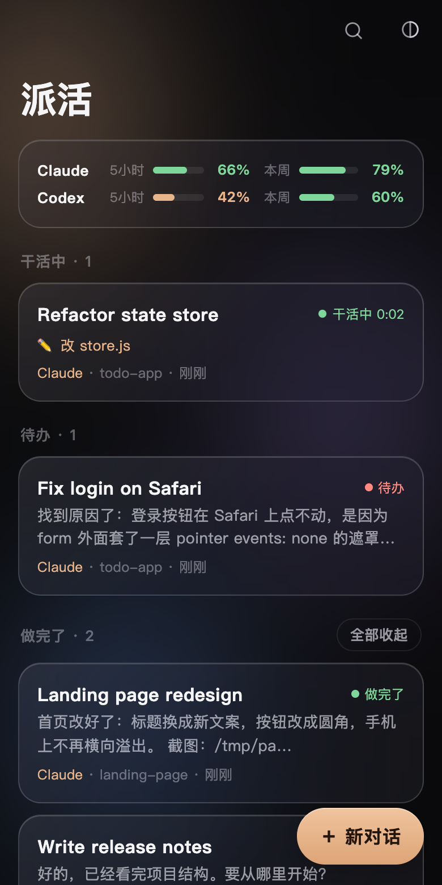
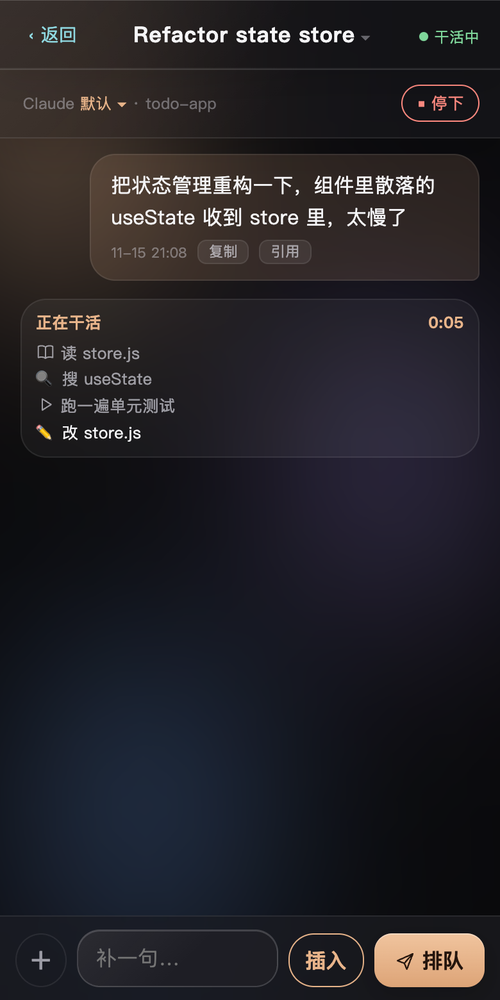
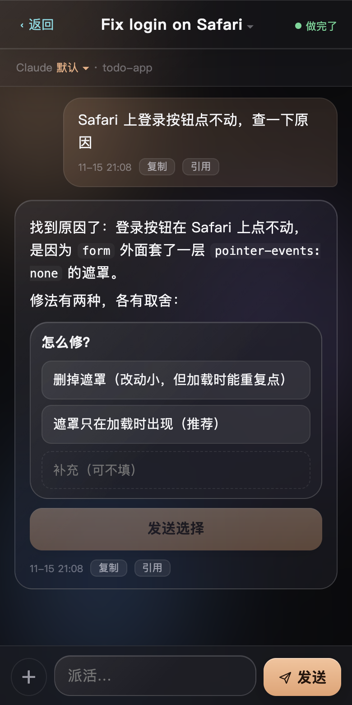
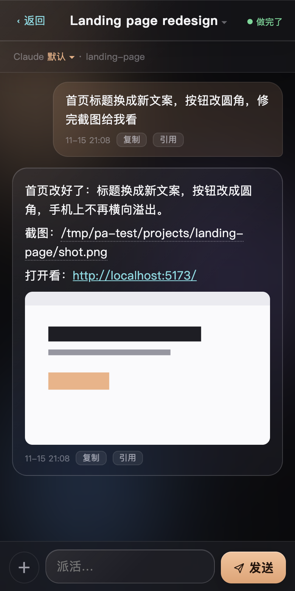
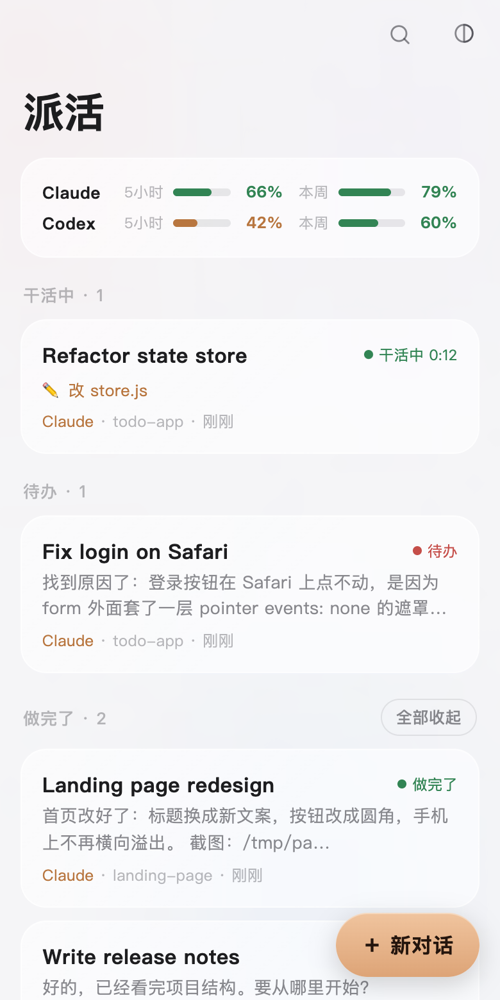

# Pocket Agent

**Hand off coding tasks to Claude Code / Codex on your computer — from your phone.**

[中文说明](README.md)

Pocket Agent is a tiny web app that runs on your own computer. Open it on your phone, pick a project, type a task, put the phone back in your pocket. The AI works on your machine with your files and tools; you get live progress, the final reply, screenshots it took, and one-tap buttons when it needs a decision.

<p>
  
  
  
  
  
</p>

- **Zero dependencies.** One Python file for the server, one HTML file for the UI. No npm, no pip, no database — conversations are JSON files in `data/`.
- **Uses the CLIs you already have.** It runs `claude -p` / `codex exec` under the hood, with your existing login and subscription. No API keys.
- **Built for the phone.** Live step-by-step progress, queue or interrupt with a follow-up while it's working, stop button, pull to refresh, dark/light theme, installable to the home screen.
- **Tap instead of type.** The AI is prompted to ask questions as ` ```choose ` blocks, which render as buttons.
- **Sees what the AI sees.** Image/video paths in replies (inside your project roots) are shown inline; attach photos from your phone.
- **Picks up desktop sessions.** Continue a Claude Code or Codex session you started in the terminal.
- **Quota at a glance.** 5-hour and weekly usage for both Claude and Codex, as reported by the tools themselves.

> **Note:** the UI is currently in Chinese only. The AI replies in whatever language you write to it (or set `system_prompt`). Translations welcome.

## ⚠️ Read this first

Pocket Agent lets anyone with the token **run an AI agent with write access on your computer** — it can edit files and run shell commands (Claude runs with `--permission-mode auto`, Codex with `workspace-write`).

- A random token is generated on first start and stored in `data/token`. Every API call requires it. Don't share it.
- By default the server listens on your **local network** (`0.0.0.0`). Only run it on networks you trust, or set `"host": "127.0.0.1"`.
- **Do not expose it directly to the internet.** It's plain HTTP with a single shared token. For access away from home, use a private network such as [Tailscale](https://tailscale.com/) or a VPN, or put it behind a reverse proxy with HTTPS and its own authentication.
- The AI can only be started inside the folders listed in `roots`, but once started it can do whatever the CLI allows. Keep your usual backups / git.

## Requirements

- macOS or Linux
- Python 3.9+ (the system Python on macOS is fine)
- [Claude Code](https://docs.claude.com/en/docs/claude-code) and/or [Codex CLI](https://github.com/openai/codex), installed and logged in

## Quick start

```bash
git clone https://github.com/RockyTata/pocket-agent.git
cd pocket-agent
cp config.example.json config.json   # then edit "roots"
python3 server.py
```

It prints something like:

```
Pocket Agent running: http://192.168.1.23:8765/
Token: 3kq8...   (new, saved in data/token)
Project roots: /Users/you/projects
```

Open that address on your phone (same Wi-Fi), enter the token, and tap **新对话** (New) to start.

Tip: in Safari use *Share → Add to Home Screen*; on Android Chrome use *Install app*.

### Keep it running

macOS (launchd) — save as `~/Library/LaunchAgents/pocket-agent.plist`, adjust paths, then `launchctl load ~/Library/LaunchAgents/pocket-agent.plist`:

```xml
<?xml version="1.0" encoding="UTF-8"?>
<!DOCTYPE plist PUBLIC "-//Apple//DTD PLIST 1.0//EN" "http://www.apple.com/DTDs/PropertyList-1.0.dtd">
<plist version="1.0"><dict>
  <key>Label</key><string>pocket-agent</string>
  <key>ProgramArguments</key><array>
    <string>/usr/bin/python3</string><string>/path/to/pocket-agent/server.py</string>
  </array>
  <key>EnvironmentVariables</key><dict>
    <!-- must include the folders where `claude` / `codex` live -->
    <key>PATH</key><string>/opt/homebrew/bin:/usr/local/bin:/usr/bin:/bin</string>
  </dict>
  <key>RunAtLoad</key><true/>
  <key>KeepAlive</key><true/>
</dict></plist>
```

Linux: a `systemd --user` service with `ExecStart=/usr/bin/python3 /path/to/pocket-agent/server.py` works the same way.

## Configuration

All settings live in `config.json` (copy from `config.example.json`). Every key is optional.

| Key | Default | Meaning |
|---|---|---|
| `roots` | `["~/projects"]` | Folders whose sub-folders show up as projects. The AI can only be started inside these. |
| `host` / `port` | `0.0.0.0` / `8765` | Where the server listens. Also `--host` / `--port` on the command line. |
| `machine_name` | hostname | Shown in the UI. |
| `claude_bin` / `codex_bin` | found on `PATH` | Full path to the CLIs if they're not on `PATH`. |
| `codex_model` | Codex default | Model passed to `codex exec -m`. |
| `codex_effort` | Codex default | `model_reasoning_effort` for Codex (e.g. `medium`). |
| `codex_models` | `[]` | Extra Codex models you can switch to from the phone. |
| `codex_cheap_model` | — | Model used to ping Codex when you refresh the quota card. |
| `system_prompt` | built-in (Chinese) | Replaces the instructions appended to every Claude run. Keep the ` ```choose ` format description if you want buttons. |

## How it works

```
phone ──HTTP──▶ server.py ──▶ console.py ──spawns──▶ claude -p … --output-format stream-json
                   │                                  codex exec --json …
                   └── index.html                      (one process per task, in your project folder)
```

- Each conversation maps to one Claude/Codex session; follow-ups use `--resume`.
- Progress is parsed from the CLI's JSON event stream and polled by the page.
- Everything is stored under `data/` (`threads.json`, `msgs/`, uploaded `files/`, `token`). Delete the folder to start fresh.
- `index.html` loads [marked](https://github.com/markedjs/marked) from jsDelivr for Markdown rendering; without it, replies show as plain text.

## License

[MIT](LICENSE)

## Author

[rocky233.vip](https://rocky233.vip)
