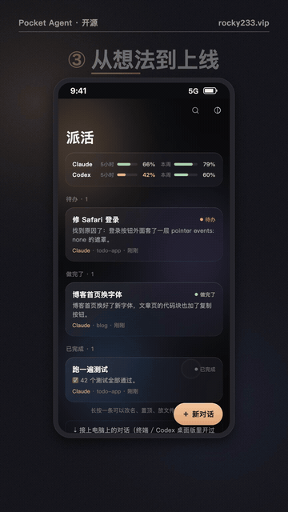
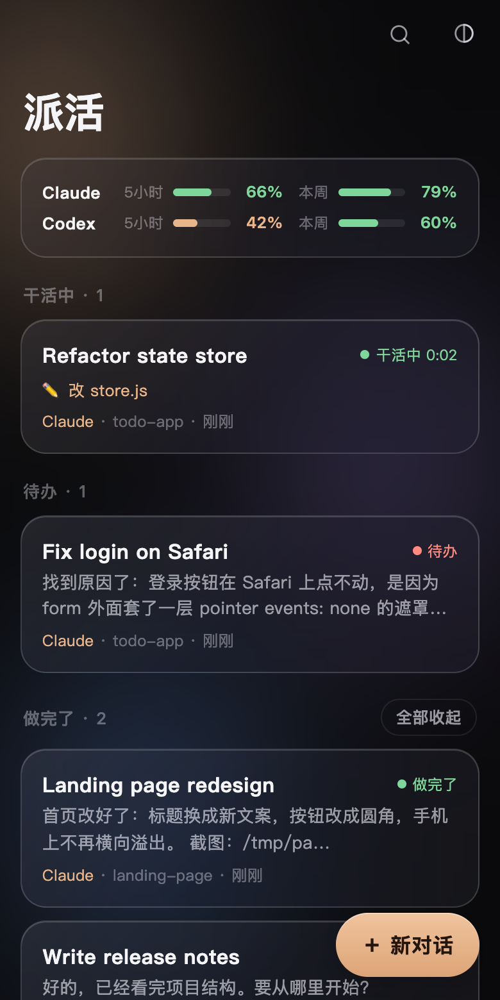
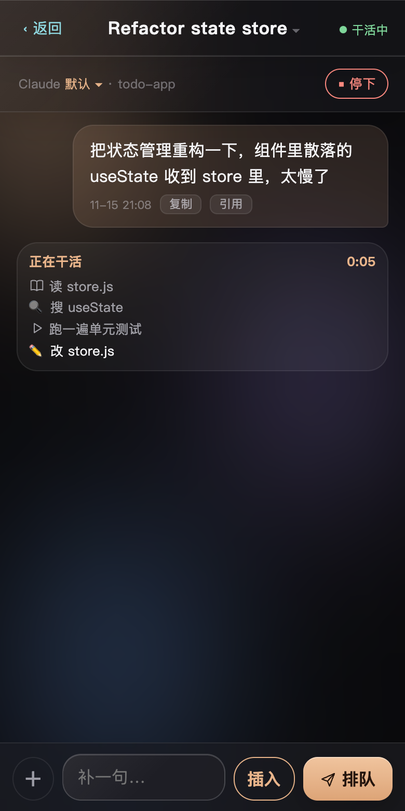
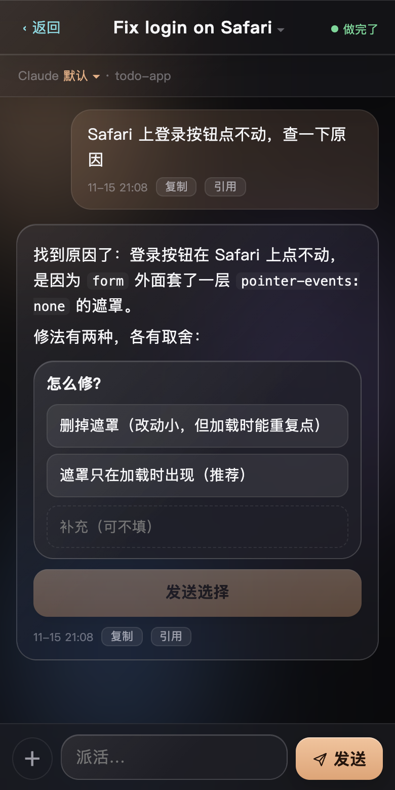
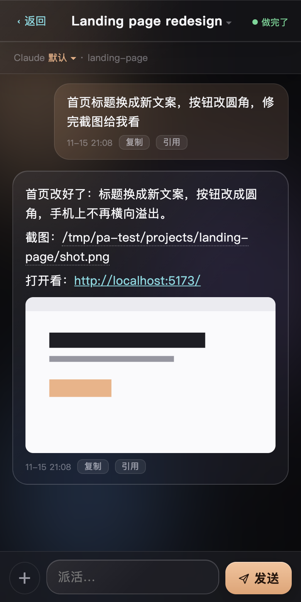
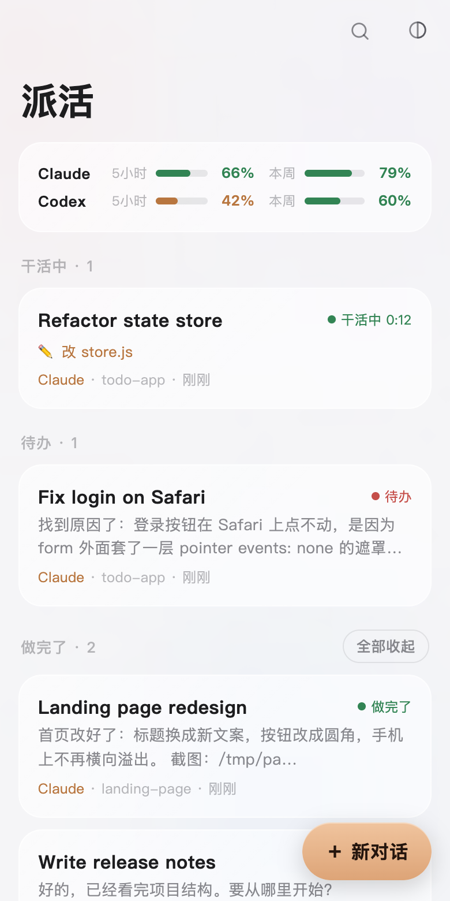

# Pocket Agent

**在手机上给电脑里的 Claude Code / Codex 派活。**

[English](README.en.md)

Pocket Agent 是一个跑在你自己电脑上的小网页。手机打开，选个项目，写一句要干什么，手机揣回兜里就行。AI 在你的电脑上用你的文件和工具干活；你在手机上能看到实时进度、最后的回复、它截的图，需要你拍板时直接点按钮。

<p align="center"></p>

<p>
  
  
  
  
  
</p>

- **零依赖。** 服务端一个 Python 文件，界面一个 HTML 文件。不用 npm、不用 pip、不用数据库，对话存成 `data/` 里的 JSON。
- **直接用你装好的命令行。** 底下跑的是 `claude -p` / `codex exec`，用你现有的登录和订阅，不需要 API Key。
- **为手机设计。** 一步步的实时进度；干活时可以补一句（排队）或者插话（打断）；随时停下；下拉刷新；夜间/白天；能加到主屏幕。
- **点，不用打字。** 提示词让 AI 用 ` ```choose ` 代码块提问，手机上显示成按钮。
- **它看到的你也看得到。** 回复里提到的图片/视频（在项目目录里的）直接显示；也能从手机传照片给它。
- **接着电脑上的对话聊。** 在终端里开的 Claude Code / Codex 会话，可以接到手机上继续。
- **额度一眼看清。** Claude 和 Codex 的 5 小时、本周用量，数字是两家工具自己报的。

## ⚠️ 先看这个

拿到口令的人就能**在你电脑上指挥一个有写权限的 AI**——它能改文件、跑命令（Claude 用 `--permission-mode auto`，Codex 用 `workspace-write`）。

- 第一次启动会随机生成口令，存在 `data/token`。所有接口都要口令，别外传。
- 默认监听**局域网**（`0.0.0.0`）。只在你信得过的网络里用，或者把 `host` 设成 `127.0.0.1`。
- **不要直接暴露到公网。** 它是明文 HTTP，只有一个共享口令。出门在外想用，走 [Tailscale](https://tailscale.com/) 这类私有网络或 VPN，或者放在带 HTTPS 和独立登录的反向代理后面。
- AI 只能在 `roots` 列出的目录里启动，但启动之后能做的事和命令行本身一样多。git 和备份照常留好。

## 需要什么

- macOS 或 Linux
- Python 3.9 以上（macOS 自带的就行）
- 装好并登录了 [Claude Code](https://docs.claude.com/en/docs/claude-code) 和/或 [Codex CLI](https://github.com/openai/codex)

## 上手

```bash
git clone https://github.com/RockyTata/pocket-agent.git
cd pocket-agent
cp config.example.json config.json   # 改一下 "roots"，写你放项目的目录
python3 server.py
```

会打印：

```
Pocket Agent running: http://192.168.1.23:8765/
Token: 3kq8...   (new, saved in data/token)
Project roots: /Users/you/projects
```

手机连同一个 Wi-Fi，打开这个地址，输入口令，点 **新对话**。

小技巧：Safari 里「分享 → 添加到主屏幕」，安卓 Chrome 里「安装应用」，用起来就像个 App。

### 开机自动跑

macOS 用 launchd：把下面存成 `~/Library/LaunchAgents/pocket-agent.plist`，改好路径，然后 `launchctl load ~/Library/LaunchAgents/pocket-agent.plist`。注意 `PATH` 要包含 `claude` / `codex` 所在的目录。

```xml
<?xml version="1.0" encoding="UTF-8"?>
<!DOCTYPE plist PUBLIC "-//Apple//DTD PLIST 1.0//EN" "http://www.apple.com/DTDs/PropertyList-1.0.dtd">
<plist version="1.0"><dict>
  <key>Label</key><string>pocket-agent</string>
  <key>ProgramArguments</key><array>
    <string>/usr/bin/python3</string><string>/path/to/pocket-agent/server.py</string>
  </array>
  <key>EnvironmentVariables</key><dict>
    <!-- 要包含 claude / codex 所在的目录 -->
    <key>PATH</key><string>/opt/homebrew/bin:/usr/local/bin:/usr/bin:/bin</string>
  </dict>
  <key>RunAtLoad</key><true/>
  <key>KeepAlive</key><true/>
</dict></plist>
```

Linux 用 `systemd --user`，`ExecStart=/usr/bin/python3 /path/to/pocket-agent/server.py`。

## 配置

都在 `config.json` 里（从 `config.example.json` 复制），每一项都可以不写。

| 项 | 默认 | 说明 |
|---|---|---|
| `roots` | `["~/projects"]` | 这些目录下的子文件夹会列成项目，AI 只能在这里面启动 |
| `host` / `port` | `0.0.0.0` / `8765` | 监听地址，命令行 `--host` / `--port` 也行 |
| `machine_name` | 主机名 | 界面上显示的电脑名 |
| `claude_bin` / `codex_bin` | 从 `PATH` 找 | 命令不在 `PATH` 里时写完整路径 |
| `codex_model` | Codex 默认 | 传给 `codex exec -m` 的模型 |
| `codex_effort` | Codex 默认 | Codex 的 `model_reasoning_effort`，比如 `medium` |
| `codex_models` | `[]` | 手机上可以切换的其他 Codex 模型 |
| `codex_cheap_model` | — | 手动刷新额度时用来「戳一下」Codex 的便宜模型 |
| `system_prompt` | 内置（中文） | 整段替换每次附加给 Claude 的说明。想保留按钮，就把 ` ```choose ` 格式那段留着 |

## 原理

- 每个对话对应一个 Claude/Codex 会话，后续消息用 `--resume` 接上。
- 进度来自命令行的 JSON 事件流，网页轮询拿。
- 所有数据在 `data/` 下（`threads.json`、`msgs/`、上传的 `files/`、`token`），删掉这个目录就是全新开始。
- `index.html` 从 jsDelivr 加载 [marked](https://github.com/markedjs/marked) 渲染 Markdown；加载不到时回复按纯文本显示。

## 许可

[MIT](LICENSE)

## 作者

[rocky233.vip](https://rocky233.vip)
